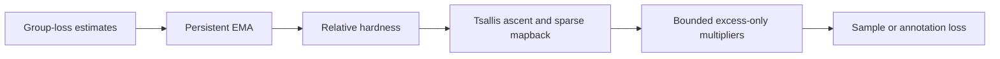

# STaR-DRO

### Stateful Tsallis Reweighting for Group-Robust Structured Prediction

**We introduce STaR-DRO, a stateful robust optimization method for supervised learning under meaningful group heterogeneity.** STaR-DRO combines Tsallis mirror ascent with sparse entmax-style primal mapback, EMA-smoothed group-loss tracking, rescaled ascent signals, and bounded excess-only multipliers. It responds to persistent group difficulty, selectively upweighting hard groups while preserving neutral supervision for easier groups.

Our framework pairs robust fine-tuning with a **six-module prompt architecture** for ontology-constrained, evidence-grounded structured generation. We evaluate it on **EPPC Miner**, which extracts hierarchical communication labels and supporting evidence from patient–provider secure messages, across **eight models from the Llama, Qwen, and Gemma families**.

**Samah Fodeh, Ganesh Puthiaraju, Elyas Irankhah, Afshan Khan, Sreeraj Ramachandran, Linhai Ma, Srivani Talakokkul, and Sarah Schellhorn**

[Method](docs/method.md) · [Prompt template](prompts/structured_prediction.md) · [EPPC Miner prompt](prompts/eppc_miner.md) · [Prepare data](docs/data_format.md) · [Run experiments](docs/quickstart.md) · [Results](docs/results.md)

## Why STaR-DRO?

Structured prediction requires a model to resolve semantic ambiguity, respect a label hierarchy, generate valid structure, and ground each decision in evidence. Some groups remain persistently difficult because of rare supervision, overlapping meanings, or metadata-dependent decision boundaries. Average-loss training can obscure these failures.

STaR-DRO directs additional learning signal to those groups through four complementary mechanisms:

- **Stateful difficulty tracking** smooths noisy minibatch observations and preserves group history across epochs.
- **Relative hardness signals** keep robust updates calibrated to the current loss landscape.
- **Sparse Tsallis reweighting** concentrates adversarial mass on groups that need sustained attention.
- **Bounded excess-only multipliers** turn hardness into controlled extra emphasis, with a neutral lower bound of one.



### Applications

STaR-DRO applies wherever meaningful groups exhibit heterogeneous difficulty. Applications include **structured annotation, named entity recognition, evidence extraction, information extraction, legal document analysis, and biomedical NLP**. In clinical extraction, useful applications include **phenotyping, adverse-event detection, and social-determinant mining**, where rare but consequential categories benefit from targeted supervision.

In EPPC Miner, these groups capture communication behaviors such as shared decision-making, partnership, socioemotional support, and social-determinant exchange. Reliable extraction supports communication analysis, care-quality assessment, and intervention design. The same group-aware mechanism also motivates future extensions to preference optimization and LLM reasoning.

## Results

We report **F1 percentages averaged over three runs** on the held-out EPPC Miner test split. SFT uses our prompt-engineered instruction.

| Llama model | SFT Code / Sub-code / Span | STaR-DRO Code / Sub-code / Span |
| --- | --- | --- |
| 1B · Llama-3.2 | 77.86 / 63.21 / 91.23 | 77.70 / 64.45 / 91.18 |
| 3B · Llama-3.2 | 78.85 / 64.90 / 91.46 | 79.98 / 66.03 / 91.00 |
| 8B · Llama-3.1 | 78.61 / 66.52 / 91.43 | 79.77 / 66.80 / 91.42 |
| 70B · Llama-3.3 | 79.24 / 67.78 / 92.38 | 81.47 / 69.30 / 91.73 |

Across Llama, Qwen, and Gemma, **we report lower group-wise validation cross-entropy in 70 of 72 model–group comparisons** relative to SFT. At 70B, STaR-DRO reaches **81.47 Code F1 and 69.30 Sub-code F1**, with **91.73 Span F1**. Our modular prompt improves average zero-shot Code, Sub-code, and Span F1 across four Llama models by **15.90, 13.02, and 17.40 points**, respectively. [Full results and grouping comparisons](docs/results.md).

## Grouping and attribution

Choose **what defines a group** and **where its multiplier acts** independently:

| Grouping | Group identity |
| --- | --- |
| Code | Parent label |
| Sub-code | Child label name |
| Code × Sub-code | Aligned parent–child pair |
| Number of annotations | Output complexity: exactly k annotation objects |
| Code × Sub-code × Number of annotations | Semantic identity and output complexity |

**Annotation attribution** routes a group's multiplier to the corresponding annotation object's tokens, allowing a hard annotation and an easier annotation in the same completion to receive different emphasis. **Sample attribution** uses the example's mean completion loss and averages its group multipliers into one sample weight, with overlap-corrected group estimates.

Our default is **Code grouping with annotation-level attribution**. [Grouping examples, objectives, and configurations](docs/grouping.md).

## Installation

Use Python 3.11 and a PyTorch build appropriate for your hardware. From the repository root:

```bash
python -m venv .venv
# Linux/macOS: source .venv/bin/activate
# Windows PowerShell: .venv\Scripts\Activate.ps1
python -m pip install --upgrade pip
python -m pip install -r requirements.txt
python -m pip install -e .
python -m pip check
```

Use `python scripts/star_dro.py` in place of `star-dro` when running from a source checkout. [Environment and software checks](docs/reproducibility.md).

## Prepare the prompt and dataset

**You supply the completed task prompt and annotated data.** Start from our [six-module Markdown template](prompts/structured_prediction.md), or the [EPPC Miner prompt](prompts/eppc_miner.md), and customize the label definitions, disambiguation rules, metadata logic, and output schema for your task.

The prompt used by the model is stored in each record's **`messages` field**. The preparation helper places your completed instruction, instance metadata, context, and target text together in **`messages[0].content`**. Gold outputs are stored separately in **`annotations`**. Training and prediction use these prepared messages with the selected model's chat template.

### 1. Complete your task template

Copy a template and edit its fenced `text` block:

```bash
python -c "from shutil import copyfile; copyfile('prompts/structured_prediction.md', 'prompts/my_task.md')"
```

Replace the bracketed slots with your complete Code/Sub-code definitions, evidence rules, metadata mappings, and verification checklist. Specify a JSON object with a `results` array containing `Code`, `Sub-code`, and `Span`. Keep this task instruction consistent across training, validation, and test.

### 2. Organize annotated source records

Create separate source JSONL files for training, validation, and test. Give each record a stable source-derived ID and keep all records from an original message or document in the same split. This nonclinical example shows the source format; write each JSONL record on one line:

```json
{
  "id": "document-001:sentence-01",
  "target_text": "The office opens at nine. Thank you.",
  "context": "Office information requested by a visitor.",
  "metadata": {"document_type": "office_information"},
  "annotations": [
    {"Code": "Topic", "Sub-code": "Schedule", "Span": "The office opens at nine."},
    {"Code": "Courtesy", "Sub-code": "Thanks", "Span": "Thank you."}
  ]
}
```

For this example, your task instruction would define Topic/Schedule and Courtesy/Thanks. For your research task, supply its complete ontology and operational definitions. Each `Span` is an exact substring of `target_text`.

### 3. Build model-ready records

```bash
python scripts/build_records.py --input data/private/train-source.jsonl --instructions prompts/my_task.md --ontology data/private/ontology.json --output data/private/train.jsonl
python scripts/build_records.py --input data/private/valid-source.jsonl --instructions prompts/my_task.md --ontology data/private/ontology.json --output data/private/valid.jsonl
python scripts/build_records.py --input data/private/test-source.jsonl --instructions prompts/my_task.md --ontology data/private/ontology.json --output data/private/test.jsonl
```

`ontology.json` maps each Code to its valid Sub-code names. The helper validates labels and evidence grounding, preserves IDs, and writes the completed prompt into each model-ready record. [Source-to-model field mapping and ontology example](docs/data_format.md#step-by-step-dataset-preparation).

### 4. Export Arrow and validate the splits

JSONL can be used directly. To create Hugging Face Arrow-backed directories:

```bash
star-dro prepare-data --input data/private/train.jsonl --output data/private/train-arrow --format arrow
star-dro prepare-data --input data/private/valid.jsonl --output data/private/valid-arrow --format arrow
star-dro prepare-data --input data/private/test.jsonl --output data/private/test-arrow --format arrow
star-dro validate-data --train data/private/train-arrow --valid data/private/valid-arrow --test data/private/test-arrow --ontology data/private/ontology.json --config configs/reference.json --output outputs/data-summary.json
```

The loader also accepts `id`/`entries` and `query`/`answer` exports. [Exact schemas and preparation options](docs/data_format.md).

## Train, merge, predict, evaluate

```bash
star-dro train --model meta-llama/Llama-3.2-3B-Instruct --train data/private/train-arrow --valid data/private/valid-arrow --ontology data/private/ontology.json --config configs/reference.json --output outputs/stardro-seed0 --seed 0 --device cuda --precision bfloat16
star-dro predict --checkpoint outputs/stardro-seed0 --input data/private/test-arrow --output outputs/stardro-seed0/predictions.jsonl --device cuda --precision bfloat16
star-dro evaluate --gold data/private/test-arrow --predictions outputs/stardro-seed0/predictions.jsonl --ontology data/private/ontology.json --output outputs/stardro-seed0/test-metrics.json
```

The reference recipe uses three continuous epochs with LoRA on attention and MLP projections and AdamW. STaR-DRO activates at epoch 2, retaining EMA and adversarial state across epochs. `configs/sft.json` selects the matched SFT baseline; `configs/standard_dro.json` selects the supplied notebook144 Standard DRO baseline (eta 0.1); [grouping configurations](docs/configuration.md) select alternative group constructions and attribution modes. Pin model/tokenizer commits with `--revision`.

For a complete three-seed experiment:

```bash
python scripts/run_experiment.py --model meta-llama/Llama-3.2-3B-Instruct --train data/private/train-arrow --valid data/private/valid-arrow --test data/private/test-arrow --ontology data/private/ontology.json --config configs/reference.json --output outputs/stardro-experiment --seeds 0,1,2 --device cuda --precision bfloat16
```

The runner validates splits, trains each seed, reports the final-epoch checkpoint (`training.checkpoint_selection: last`, the manuscript protocol; `validation_ce` selects the lowest validation completion CE instead), merges the selected LoRA weights temporarily, generates test predictions with vLLM, and aggregates means and sample standard deviations. Runs retain configurations, data hashes, model revisions, group inventories, training diagnostics, and checkpoints. [Complete runbook](docs/quickstart.md) · [Checkpoint resumption and inference](docs/usage.md).

Prediction uses vLLM on CUDA with temperature 0, `JSON_END` stopping, and automatic temporary model merging. Default vLLM tensor parallelism is 1, GPU memory utilization 0.7, and inference batch size 1. `--max-new-tokens` retains its 512 default; pass 1024 for the notebook's test budget. Use `--merge-temp-dir` for a filesystem with room for full merged weights; these are deleted after testing. The train, merge, and inference stages use separate processes to release GPU state. Explicit `star-dro merge` exports a persistent full model when needed. [Merge/vLLM options and checkpoint-only smoke test](docs/quickstart.md#vllm-and-merge-settings).

## Scorer and hardness-scale options

The scorer contains no built-in label inventory. Code and Sub-code labels come from the ontology JSON you pass with `--ontology` (the same file used to prepare and validate your data); without it, the inventory is taken from the gold annotations and the result records that choice. Code and Sub-code use micro precision/recall/F1 over per-record label sets; Span uses relaxed token matching (containment, or Jaccard >= `--span-threshold`, default 0.6), one-to-one. Predicted labels are normalized (case, spacing, underscores, "/" spacing) and near misses are fuzzy-mapped to inventory labels; `--exact-labels` disables fuzzy mapping. Predicted labels outside the inventory are ignored by default, as in the manuscript, and always counted in the output; `--unknown-labels count` scores them as false positives. RapidFuzz is optional (difflib fallback); results record the backend. [Evaluation protocol](docs/evaluation.md).

`star_dro.hardness_scale` accepts `count` (the unchanged default) or `uniform` (the notebook157 present-group mean). Use `configs/uniform_scaling.json` for the latter; it changes only this field. Default LoRA targets now match the notebook: q_proj, k_proj, v_proj, o_proj, gate_proj, up_proj and down_proj. Other numeric defaults are unchanged.

## Data availability

As stated in the manuscript, **the datasets generated and analyzed during our study are not publicly available because access to data derived from patient–provider secure messages is restricted by the IRB to protect patient privacy**. Researchers can apply STaR-DRO to their own authorized data using the preparation workflow above. [Study context and data access](docs/data_availability.md).

## Repository and software checks

```text
src/star_dro/     Adversary, grouping, objectives, prompt assembly, data and metrics
prompts/          General modular template and EPPC Miner instruction in Markdown
configs/          Reference recipe, SFT baseline and grouping examples
schemas/          Input and prediction contracts
scripts/          Dataset preparation, experiments, tests and release packaging
tests/            Numerical, gradient, storage, metric and model integration checks
docs/             Method, data preparation, evaluation and reproducibility
```

```bash
python scripts/run_tests.py --require-torch --require-data --require-model
python scripts/package_release.py
```

Add `--output PATH.zip` to the packaging command to create a reviewer archive with a file-hash manifest. [Implementation guide](docs/paper_alignment.md) · [Reproducibility](docs/reproducibility.md).

## Citation

Please cite **STaR-DRO: Stateful Tsallis Reweighting for Group-Robust Structured Prediction** using [CITATION.bib](CITATION.bib) or [CITATION.cff](CITATION.cff). See [LICENSE](LICENSE) for review terms. Correspondence: **Samah Fodeh**, [samah.fodeh@yale.edu](mailto:samah.fodeh@yale.edu).
